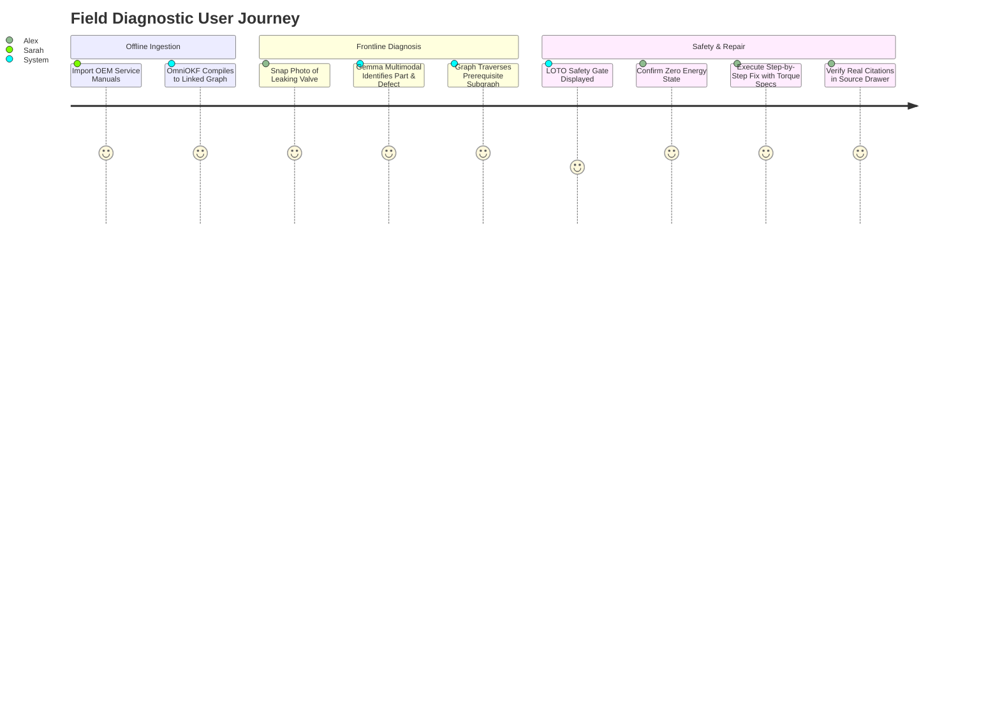
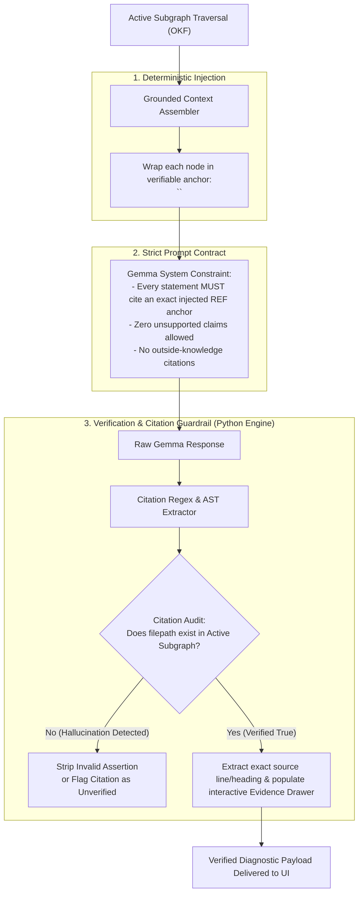

# Product Requirements Document (PRD)

## Project: Field Engineering & Hardware Diagnostic Engine (OmniOKF + Multimodal Gemma)
**Document Version:** 1.0.0  
**Classification:** Production Engineering Specification  
**Status:** Approved for Implementation  
**Target Deployment:** Edge / Offline Frontline Industrial Devices (Laptops, Rugged Tablets)

---

## 1. Executive Summary & Problem Definition

### 1.1 The Frontline Industrial Reality
Field service engineers and technicians servicing high-value industrial assets—such as offshore wind turbines, commercial aviation powerplants, subterranean pump skids, and mining machinery—operate under harsh, high-risk conditions:
- **Zero or Degraded Connectivity**: Deep nacelles, reinforced hangars, and offshore platforms lack reliable internet access. Cloud-dependent AI solutions (e.g., standard SaaS RAG, cloud vector stores) fail immediately.
- **Documentation Overload**: Assets are accompanied by 1,000 to 10,000 pages of fragmented technical documentation, service bulletins, schematics, and Lockout/Tagout (LOTO) protocols across disparate PDFs, Word files, and spreadsheets.
- **Catastrophic Failure & Safety Risk**: In aviation and high-pressure industrial systems, incorrect torque, missed safety isolation steps, or hallucinated AI advice can lead to arc flashes, hydraulic explosions, equipment destruction, or loss of life.
- **Manual Lookup Friction**: Searching for a faulty component or decoding a 3-blink diagnostic LED pattern requires manually flipping through manuals with greasy gloves, causing extended Mean Time to Repair (MTTR) and massive downtime costs ($10,000–$50,000/hr).

### 1.2 The Solution
The **Field Engineering & Hardware Diagnostic Engine** is an offline-first, multimodal edge diagnostic system. It combines:
1. **OmniOKF Ingestion Compiler (`gemini-okf-compiler`)**: Automatically converts fragmented enterprise documents into an interconnected Open Knowledge Format (OKF) graph with YAML frontmatter, atomic concept nodes, and deterministic relative links.
2. **Multimodal Gemma Edge Engine**: Accepts photos of damaged components, burnt PCBs, error code displays, or hands-free technician voice notes.
3. **Deterministic Graph Traversal**: Resolves visual and auditory findings directly into concrete OKF graph nodes, traversing upstream safety prerequisites (LOTO/PPE) and downstream repair sequences.
4. **Zero-Hallucination Verifiable Citation Engine**: Enforces strict node-anchored citations. Every diagnostic instruction is tied to verifiable, locally stored source markdown nodes, mathematically rejecting fabricated references.
5. **Mandatory Safety Interlock Gate**: Hard-blocks physical wrenching procedures until all upstream safety isolations are confirmed by the technician.

---

## 2. Target Personas & Core User Journeys

### 2.1 Personas
- **Primary: Frontline Field Technician ("Alex")**: Works in remote nacelles and engine rooms; wears PPE; needs fast visual identification, clear step-by-step guidance, and hands-free voice support.
- **Secondary: Lead Operations / Plant Safety Engineer ("Sarah")**: Responsible for safety compliance (OSHA LOTO); imports updated OEM service bulletins and requires verifiable proof that AI recommendations adhere strictly to official manuals.

### 2.2 Core User Scenarios



---

## 3. High-Integrity Verifiable Citation Engine (Anti-Hallucination Architecture)

A critical requirement is that **the model must never produce fake or hallucinated citations**. Traditional RAG and LLM chatbots hallucinate believable chapter numbers or non-existent page references. In this system, citation validity is guaranteed deterministically.



### 3.1 Verification Rules
1. **Closed-World Node Enclosure**: The model is only provided with traversed subgraph nodes. Each node carries a standardized anchor header:
   ```markdown
   <!-- REF_START: components/proportional_relief_valve_v2.md -->
   # Proportional Pressure Relief Valve V2
   ...
   <!-- REF_END: components/proportional_relief_valve_v2.md -->
   ```
2. **Deterministic Citation Syntax**: Citations in Gemma's output must follow:
   `[^components/proportional_relief_valve_v2.md#specifications]`
3. **Backend Citation Verifier (`CitationAuditor`)**:
   - Parses all citation markers via regular expression.
   - Cross-references each cited path against the active `InMemoryGraph`.
   - Checks that the anchor heading exists in the physical markdown file.
   - If a citation references a non-existent file or section, the assertion is automatically flagged with `status: "unverified_citation"`, and the system logs an audit alert.
4. **Frontend Evidence Drawer**: Clicking any citation in the UI opens the exact source markdown node side-by-side with high-contrast highlighting of the referenced paragraph.

---

## 4. Functional Requirements

### 4.1 Ingestion & Knowledge Base Management (OmniOKF Engine)
- **FR-1.1 Universal Document Ingestion**: Ingests `.pdf`, `.docx`, `.xlsx`, `.pptx`, `.html`, and `.md` files without heavy external binaries.
- **FR-1.2 Layout-Aware Parsing**: Reconstructs hierarchical headings (`#`, `##`, `###`) and preserves data tables and callout blocks.
- **FR-1.3 Semantic Concept Splitting**: Partitions files into atomic concept nodes (200–500 tokens).
- **FR-1.4 Gemma Frontmatter Enrichment**: Automatically populates YAML frontmatter: `type`, `title`, `description`, `tags`, `safety_level`, and `part_numbers`.
- **FR-1.5 Dynamic Cross-Linking**: Computes cross-references using relative Markdown links (`[Lockout Protocol](../safety/lockout_hydraulics.md)`) with TF-IDF collision prevention.
- **FR-1.6 Incremental Hash Caching**: Uses MD5 hashes (`manifest.json`) to skip re-indexing unmodified documents.
- **FR-1.7 Master Graph Index**: Generates root `index.md` with category taxonomies and embedded Mermaid dependency graphs.

### 4.2 Multimodal Field Ingestion
- **FR-2.1 Image Processing**: Accepts camera snapshots or file uploads (JPEG, PNG, WEBP) of physical machinery, damaged electronics, gauges, nameplates, and LED indicator lights.
- **FR-2.2 Audio Processing**: Accepts field voice notes (WAV, MP3, WebM) recorded via browser or microphone input.
- **FR-2.3 Direct Text / Metric Input**: Accepts typed text, part numbers, serial codes, or multimeter readings.

### 4.3 Multimodal Gemma Diagnostics & Graph Traversal
- **FR-3.1 Visual Feature Extraction**: Gemma Multimodal extracts:
  - Equipment model / part number.
  - Observed physical anomaly (e.g., burned PCB capacitor, oil weepage, mechanical scoring).
  - Telemetry state (analog gauge reading, LED blink pattern).
- **FR-3.2 Deterministic Subgraph Resolution**: Matches detected entities to entry nodes in the local OKF graph.
- **FR-3.3 Upstream Prerequisite Traversal**: Programmatically traverses incoming edges to gather mandatory safety rules, isolation procedures, and PPE requirements.
- **FR-3.4 Downstream Execution Traversal**: Gathers required tools, torque specifications, replacement steps, and post-repair functional tests.

### 4.4 Safety Interlock & Guided Remediation
- **FR-4.1 Safety Gate Enforcement**: If any upstream safety node exists (e.g., `#lockout-tagout`, `#high-voltage`), the UI locks procedural steps behind an explicit safety verification gate.
- **FR-4.2 Step-by-Step Interactive Checklist**: Formats repair steps into checkable items with required torque values, fastener grades, and tool requirements.
- **FR-4.3 Multi-Turn Clarification**: If visual confidence is ambiguous (e.g., blurry image, multiple matching valve models), the system prompts the technician with visual disambiguation questions.

---

## 5. Non-Functional Requirements

| Category | Specification | Verification Method |
|---|---|---|
| **Zero Cloud Dependencies** | 100% of graph indexing, document parsing, link traversal, and UI assets run locally. The only external API allowed is the Gemma API (or local Gemma instance). No cloud vector DBs (Pinecone, etc.) or cloud storage (S3). | Disconnect machine from network (except Gemma host/API proxy); all features remain functional. |
| **Response Latency** | Graph resolution and context assembly must complete in `< 500ms`. Gemma multimodal response generation within `< 5.0s`. | Benchmark test suite measuring end-to-end latency. |
| **Code Modularity** | All source code files strictly `< 300 lines`. Strict TypeScript interfaces on frontend, strict Pydantic v2 schemas on backend. | Static analysis and linter checks (`flake8`, `mypy`, `eslint`). |
| **UI Aesthetics & Ruggedness** | High-contrast industrial theme (amber, slate, charcoal). Accessible under bright outdoor sunlight and dark engine bays (WCAG AAA contrast compliance). | UI visual inspection and axe-core accessibility tests. |
| **Citation Verifiability** | 100% of emitted citations must correspond to valid, existing OKF nodes in the active graph. Zero tolerance for unverified references. | Automated citation audit test verifying 0% hallucinated links. |

---

## 6. Data Schemas & Graph Specifications

### 6.1 OKF Node YAML Frontmatter Schema
```yaml
---
id: "COMP-PRV-992-B"
type: "component" # enum: component | procedure | safety | tool | fault_code
title: "Proportional Pressure Relief Valve V2"
description: "Direct-operated hydraulic relief valve for yaw brake pressure regulation."
tags: ["hydraulics", "yaw-system", "pressure-control"]
subsystem: "Nacelle Yaw Hydraulics"
part_numbers: ["PRV-992-B", "PRV-992-C"]
safety_prerequisites:
  - "../safety/lockout_tagout_hydraulics.md"
  - "../safety/hydraulic_depressurization.md"
required_tools:
  - "../tools/calibrated_torque_wrench.md"
procedures:
  - "../procedures/valve_seal_replacement.md"
timestamp: "2026-10-31T11:00:00Z"
---
```

### 6.2 Diagnostic API Contract

#### `POST /api/diagnose`
**Request (Multipart / Form-Data):**
- `image`: Binary file (optional if audio/text provided)
- `audio`: Binary file (optional)
- `query_text`: String (optional description or part number)
- `active_subsystem`: String (optional filter)

**Response (`DiagnosticResponse` Pydantic Model):**
```json
{
  "diagnostic_id": "diag_8f3a91",
  "detected_component": {
    "name": "Proportional Pressure Relief Valve V2",
    "part_number": "PRV-992-B",
    "node_path": "components/proportional_relief_valve_v2.md",
    "confidence": 0.94,
    "observed_defect": "Blown Viton O-ring seal with high-pressure fluid weepage around collar"
  },
  "safety_interlocks": {
    "required": true,
    "acknowledged": false,
    "prerequisites": [
      {
        "id": "SAFE-LOTO-01",
        "title": "Hydraulic Accumulator Lockout & Depressurization",
        "node_path": "safety/lockout_tagout_hydraulics.md",
        "checklist": [
          "De-energize main hydraulic pump motor breaker (CB-4)",
          "Attach personal safety padlock and LOTO tag to valve HV-01",
          "Open manual bleed needle valve NV-03 and verify zero pressure on gauge PG-02"
        ],
        "citation": "[^safety/lockout_tagout_hydraulics.md#isolation-procedure]"
      }
    ]
  },
  "remediation_plan": {
    "title": "Valve O-Ring Seal Replacement & Recalibration",
    "required_tools": [
      {
        "name": "Calibrated 1/2\" Torque Wrench (10-100 Nm)",
        "node_path": "tools/calibrated_torque_wrench.md",
        "citation": "[^tools/calibrated_torque_wrench.md#calibration-standard]"
      }
    ],
    "steps": [
      {
        "step_number": 1,
        "instruction": "Clean exterior valve cavity using lint-free industrial wipes.",
        "torque_spec": null,
        "citation": "[^procedures/valve_seal_replacement.md#step-1-cleaning]"
      },
      {
        "step_number": 2,
        "instruction": "Loosen 4x M10 hex socket head cap screws in cross-diagonal sequence.",
        "torque_spec": "35 Nm upon reassembly",
        "citation": "[^procedures/valve_seal_replacement.md#step-2-disassembly]"
      }
    ]
  },
  "citations": [
    {
      "citation_id": "cite_1",
      "node_path": "components/proportional_relief_valve_v2.md",
      "heading": "Specifications",
      "exact_source_text": "Fastener Torque: 35 Nm (M10 Class 10.9 with light machine oil lubricant).",
      "verification_status": "verified"
    }
  ]
}
```

---

## 7. Safety & Compliance Architecture (OSHA 1910.147 Alignment)

In industrial automation and field service, OSHA Standard 1910.147 (The Control of Hazardous Energy) requires zero energy verification before maintenance:
1. **Software-Enforced LOTO Gate**: The web client disables interaction on the repair sequence until each check item in `safety_interlocks.prerequisites` is explicitly toggled and signed off by the technician.
2. **Audit Logging**: Every diagnostic session records a timestamped, tamper-evident JSON audit record containing:
   - Input image hash.
   - Identified part and confidence score.
   - Verified citations list.
   - Signed safety checklist items.
   - Technician ID and local timestamp.

---

## 8. Technology Stack Summary

| Subsystem | Technology | Purpose |
|---|---|---|
| **API Framework** | Python 3.10+ / FastAPI | High-throughput, async REST API with automatic OpenAPI docs |
| **Type Validation** | Pydantic v2 | Strict request/response validation and schema enforcement |
| **Ingestion Engine** | Microsoft MarkItDown + PyMuPDF | Document parsing into clean markdown with layout headers |
| **Model Runtime** | Google GenAI SDK (Gemma / Gemini) | Multimodal visual inspection, concept extraction, reasoning |
| **Graph Engine** | NetworkX (In-Memory) | Zero-database directed knowledge graph & link traversal |
| **Fuzzy / Lexical Match** | RapidFuzz + BM25 | Instant local sub-millisecond node resolution |
| **Web Frontend** | React 19 / Vite / Tailwind CSS / Lucide | High-contrast, sunlight-readable field engineering UI |

---

## 9. Test & Verification Plan

1. **Unit Testing**:
   - `test_okf_parser.py`: Verify PDF/Docx layout extraction and header preservation.
   - `test_linker.py`: Verify relative path generation and TF-IDF link resolution.
   - `test_graph_engine.py`: Verify NetworkX graph building, cycle detection, and upstream/downstream traversal.
   - `test_citation_auditor.py`: Ingest synthetic outputs with valid and fabricated citations; prove 100% detection of fake citations.
2. **Integration Testing**:
   - End-to-end test from sample document upload -> OKF compilation -> image upload -> safety gate -> verified citation output.
3. **Offline Integrity Verification**:
   - Run backend and frontend with physical network interface disabled (with mock or local model proxy) to guarantee zero leakage to external cloud endpoints.

