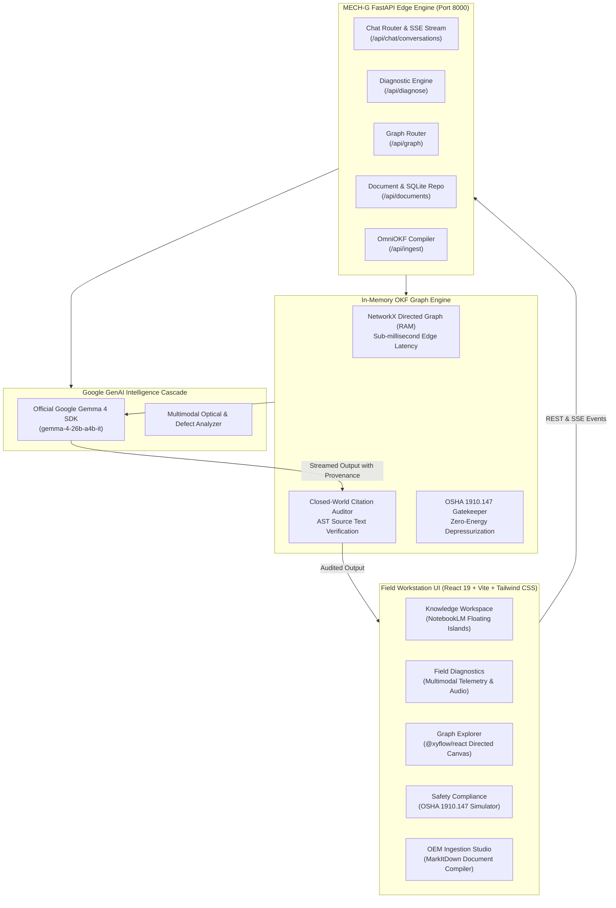

# ⚙️ MECH-G: Multimodal Edge Diagnostic & Engineering Knowledge Workspace

<div align="center">


-3B82F6?style=for-the-badge&logo=google)


<p align="center">
  <strong>An offline-first, multimodal AI knowledge workspace and field diagnostic engine for high-value industrial machinery.</strong><br>
  Built with <strong>Google Gemma 4 (26B)</strong>, deterministic <strong>Open Knowledge Format (OKF)</strong> graph reasoning, and strict <strong>OSHA 1910.147 Lockout/Tagout (LOTO)</strong> safety gate enforcement.
</p>

</div>

---

## 🌟 Executive Overview

High-value industrial assets—wind turbines, multi-stage gas turbines, hydraulic power units, and automated manufacturing systems—operate in demanding environments where downtime costs thousands of dollars per minute and hallucinated instructions can cause fatal accidents.

**MECH-G** solves this challenge by unifying:
1. **Google Gemma 4 (`gemma-4-26b-a4b-it`)**: Official Google GenAI SDK multimodal vision and language model fine-tuned for complex mechanical diagnostics and closed-world synthesis.
2. **OmniOKF Compiler**: Layout-aware document parsing pipeline converting dense OEM manuals (PDF, DOCX, XLSX, Markdown) into modular, deterministic Markdown nodes with structured YAML frontmatter.
3. **Zero-Cloud In-Memory Directed Topology (NetworkX)**: An in-memory graph engine providing sub-millisecond graph traversals, collision-safe part number resolution, and 2-hop contextual subgraphs without relying on external vector databases.
4. **Deterministic Closed-World Citation Auditor**: An AST guardrail validating all citations (`[^node/path.md#heading]`) against verified knowledge graph excerpts. Hallucinated facts without direct provenance are mathematically purged before reaching the field technician.
5. **OSHA 1910.147 LOTO Safety Interlocks**: Hard safety gate requiring certified technician badge sign-off and zero-energy pressure/voltage depressurization before procedural repair steps unlock.

---

## 🏛️ System Architecture



---

## 🚀 Key Modules & Capabilities

### 1. 💬 Knowledge Workspace (`/` and `/workspace`)
- **NotebookLM 3-Panel Floating Island UI**: Built on `#0B0B0C` obsidian canvas with `#18181A` rounded surfaces (`rounded-[24px]`).
- **Conversational SSE Streaming**: Real-time token streaming from Gemma 4 with real-time status notifications.
- **Interactive Knowledge Mindmap**: Synchronized `@xyflow/react` graph panel automatically highlighting active nodes during discussion.
- **Connector-Aware Mermaid Flowchart Renderer**: Automatically detects, sanitizes, and renders workflow diagrams directly inline.
- **Hero Onboarding**: Features "Where should we start?" greeting in Google Sans / Plus Jakarta Sans typography.

### 2. 🔧 Multimodal Field Diagnostics (`/diagnostics`)
- **Multimodal Telemetry Ingestion**: Capture physical component photography, acoustic audio frequencies (harmonic FFT chatter), and diagnostic error codes (`E-302`, `F-104`).
- **Interactive Telemetry Controls**: Real-time hydraulic manifold pressure (`0–350 bar`) and reservoir fluid temperature (`20–120 °C`) sliders.
- **OSHA 1910.147 Safety Gate Modal**: Strict lock enforcing technician badge ID input and zero-energy checks before unlocking step-by-step repair checklists.
- **Interactive Checklist**: Mark completed steps with automatic torque specification highlights and tool requirements.
- **Field Work Order Modal**: Instant printable field service ticket (`WO-2026-MECHG-891`).

### 3. 🕸️ Knowledge Graph Explorer (`/graph`)
- **Fullscreen React Flow Topology**: Interactive directed canvas rendering components, safety prerequisites, procedures, fault codes, and calibrated tools.
- **Fuzzy Search & Category Filtering**: Instant token-level search across part numbers, descriptions, and relative OKF paths.
- **In-Page Node Detail Inspector Modal**: Inspect YAML frontmatter, part numbers, upstream safety prerequisites, and downstream dependent nodes.
- **One-Click Gemma Query Hand-off**: Click "Ask Gemma About Node" to transition directly into the conversational canvas with prepopulated engineering prompts.

### 4. 📄 OEM Ingest & Markdown Compiler Studio (`/ingest`)
- **Multi-Format Ingestion**: Drag-and-drop support for PDF schematics, Word manuals, Excel tables, and Markdown files.
- **OmniOKF Compiler**: Uses MarkItDown and PyMuPDF to extract text, tables, and headers, structuring them into discrete Markdown nodes.
- **Live Execution Console**: Real-time terminal output tracking document parsing, AST extraction, and SQLite provenance tracking.
- **In-Page Generated Nodes Modal**: Inspect generated nodes for any uploaded manual with one click.

### 5. 🛡️ Safety Compliance & LOTO Interlocks (`/safety`)
- **OSHA 29 CFR 1910.147 Simulator**: 6-step interactive sequence (Notify, E-Stop, Electrical Isolation, Lockout/Tagout, Depressurization, Zero-Test).
- **Mandatory PPE Equipment Checklist**: Helmet, impact eyewear, Category 2 arc flash shield, and 1000V gloves.
- **Digital LOTO Permit System**: Issue, track, and print verified isolation permits with padlock serial numbers and technician signatures.

### 6. 🔥 Ambient AI Plasma Flame Animation
- **Global Neural Feedback**: Radiant, sleek, modern background plasma flame (cyan, violet, and amber embers) that gracefully illuminates while Gemma is thinking, evaluating telemetry, or compiling documents.

---

## 💻 Tech Stack

| Layer | Technologies |
|---|---|
| **Frontend Framework** | React 19, TypeScript, Vite 8, React Router v7 |
| **Design System** | Tailwind CSS v4, Plus Jakarta Sans, Outfit, Lucide Icons |
| **Interactive Graph** | `@xyflow/react` v12, Dagre Layout Engine |
| **Math & Diagrams** | Mermaid v12, KaTeX, React-Markdown, Remark-GFM, Rehype-KaTeX |
| **Backend API** | FastAPI, Uvicorn, Python 3.10+, Pydantic v2 |
| **Multimodal Intelligence**| Google GenAI SDK (`google-genai`), `gemma-4-26b-a4b-it` |
| **Document Compiler** | Microsoft MarkItDown, PyMuPDF (fitz) |
| **Graph & Storage** | NetworkX (In-Memory RAM), SQLite (`workspace.db`), OKF Markdown Bundle |

---

## ⚡ Quick Start Guide

### 1. Clone the Repository
```bash
git clone https://github.com/vishal-raaj-dnd/PROJECT-GEMMA.git
cd PROJECT-GEMMA
```

### 2. Configure Backend Environment
Create `backend/.env` with your Google GenAI API key:
```bash
cp backend/.env.example backend/.env
```
Edit `backend/.env`:
```env
# Official Google GenAI / Gemma API Key
GEMMA_API_KEY=your_gemini_or_gemma_api_key_here

# Target Multimodal Model
GEMMA_MODEL=gemma-4-26b-a4b-it

# Server Settings
HOST=0.0.0.0
PORT=8000
CORS_ORIGINS=http://localhost:3000,http://localhost:5173
```
*(Note: If no API key is supplied, MECH-G runs in offline fallback mode using deterministic edge heuristics, ensuring 100% offline development).*

### 3. Start Backend Server
```powershell
# Using the pre-configured virtual environment:
.\.venv\Scripts\python.exe run_backend.py
```
Backend will start on **`http://localhost:8000`**.  
Interactive OpenAPI Swagger docs: **`http://localhost:8000/docs`**

### 4. Start Frontend Client
```bash
cd frontend
npm install
npm run dev
```
Frontend will start on **`http://localhost:3000`**.

---

## 🧪 Automated Test Suite

MECH-G includes unit, integration, and graph consistency tests:
```powershell
.\.venv\Scripts\pytest backend/tests -v
```

Tests verify:
- In-memory NetworkX directed graph traversal & cycle detection
- Deterministic part number and fuzzy token resolution
- Closed-world citation auditing & hallucination stripping
- OSHA 1910.147 Lockout/Tagout gate logic & sign-off persistence
- Multi-format OmniOKF document compilation & AST node linking

---

## 🚢 Production Deployment

### Production Frontend Build
```bash
cd frontend
npm run build
```
Creates an optimized static bundle in `frontend/dist/` with chunked KaTeX fonts, code-splitting, and minified CSS.

### Production Backend Serving
```powershell
.\.venv\Scripts\uvicorn app.main:app --app-dir backend --host 0.0.0.0 --port 8000 --workers 4
```

### Docker Containerization (Optional)
```dockerfile
FROM python:3.11-slim
WORKDIR /app
COPY backend/requirements.txt .
RUN pip install --no-cache-dir -r requirements.txt
COPY backend/ ./backend
EXPOSE 8000
CMD ["python", "backend/run_backend.py"]
```

---

## 📖 Citation Format (OKF Specification)

All engineering assertions synthesized by MECH-G reference deterministic knowledge nodes using GitHub Flavored Markdown citations:
```markdown
Verify hydraulic accumulator pressure is below 5 PSI [^safety/lockout_tagout_hydraulics.md#zero-energy-state].
Tighten hex collar bolts to 45 Nm using calibrated torque wrench [^tools/calibrated_torque_wrench.md#specifications].
```

---

## 📄 License

This project is licensed under the Apache 2.0 License. Designed for mission-critical industrial maintenance and engineering education.
