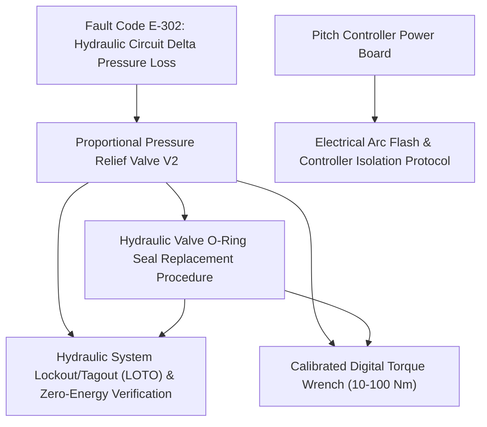

# Knowledge Catalog Index

Structured graph index of all available equipment, safety protocols, and repair procedures.

## 📊 Knowledge Graph

## Catalog by Category

### Components
- **[Proportional Pressure Relief Valve V2](./components/proportional_relief_valve_v2.md)** - Direct-acting hydraulic proportional valve regulating yaw drive brake pressure. *(hydraulics, yaw-system, pressure-relief, valve)*
- **[Pitch Controller Power Board](./components/pcb_pitch_controller_v1.md)** - Main switching power supply and gate driver PCB for turbine pitch servo actuators. *(electronics, pcb, pitch-system)*

### Fault_codes
- **[Fault Code E-302: Hydraulic Circuit Delta Pressure Loss](./fault_codes/code_e302_pressure_drop.md)** - Main turbine controller alarm triggered when yaw system pressure drops below 160 bar during brake hold. *(fault-code, alarm, yaw-system)*

### Procedures
- **[Hydraulic Valve O-Ring Seal Replacement Procedure](./procedures/valve_seal_replacement.md)** - Standard operating procedure for replacing degraded or extruded seals on PRV series relief valves. *(procedure, maintenance, hydraulics)*

### Safety
- **[Hydraulic System Lockout/Tagout (LOTO) & Zero-Energy Verification](./safety/lockout_tagout_hydraulics.md)** - Mandatory isolation procedure before servicing any pressurized hydraulic lines or solenoid valves. *(safety, hydraulics, loto, osha)*
- **[Electrical Arc Flash & Controller Isolation Protocol](./safety/arc_flash_ppe_level2.md)** - Mandatory safety procedures when opening main turbine pitch and yaw controller enclosures. *(safety, electrical, arc-flash, ppe)*

### Tools
- **[Calibrated Digital Torque Wrench (10-100 Nm)](./tools/calibrated_torque_wrench.md)** - Precision digital torque wrench with angle measurement for structural fastener assemblies. *(tool, calibration, torque)*
