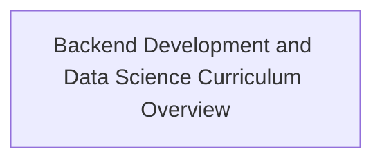

# Knowledge Catalog Index

Structured graph index of all available equipment, safety protocols, and repair procedures.

## 📊 Knowledge Graph

## Catalog by Category

### Component

- **[Backend Development and Data Science Curriculum Overview](./component/backend-development-curriculum-overview.md)** - A comprehensive list of examination topics covering backend development, algorithms, data structures, data science, statistics, and AI ethics. *(curriculum, exam-topics, backend-development, data-science, computer-science)*
